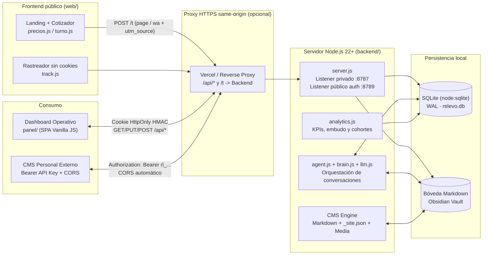

# Relevo — Full-Stack Operations Platform, Dashboard & Headless CMS

Plataforma web y operativa completa diseñada y construida desde cero en **JavaScript / Node.js 22+** (sin frameworks pesados ni ORMs), que integra:

1. **Sitio público + cotizador determinístico (`web/`)**: landing page con cálculo de rangos en tiempo real y telemetría ligera **sin cookies** (`POST /t`).
2. **Dashboard operativo con barra lateral (`panel/`)**: gestión diaria de pedidos, clientes, cobranza, bandeja interactiva de WhatsApp, analítica de negocio, monitor de cursos y un **CMS personal en Markdown**.
3. **Backend modular + SQLite WAL + API REST segura (`backend/`)**: servidor HTTP nativo con doble listener (red privada + acceso público autenticado), autenticación `scrypt` + cookie `HttpOnly` firmada con HMAC-SHA256, API Keys `Bearer` con CORS para CMS externos, sincronización bidireccional con bóveda Markdown (Obsidian) y orquestación multi-LLM con respaldo automático.

> **Nota de privacidad:** este repositorio público está 100% sanitizado para portafolio. No incluye bases de datos reales, credenciales, sesiones, números telefónicos ni información de clientes. Incluye un modo demo completo ejecutable localmente en menos de 1 minuto.

---

## Arquitectura general y flujo de datos



### Cómo viajan y se transforman los datos

1. **Captura en la página pública (`web/`)**
   - `assets/js/precios.js` calcula rangos y precios sugeridos de forma determinística (compartido entre el sitio público y el cotizador interno del dashboard).
   - `assets/js/track.js` detecta `utm_source` o `document.referrer` (sin cookies ni PII) y envía eventos mínimos (`{ type: "page" | "wa", path, src }`) mediante `fetch(..., { keepalive: true })` hacia `POST /t`.
2. **Persistencia unificada (`backend/src/db.js` + `vault.js`)**
   - **`SQLite` nativo (`node:sqlite`, modo WAL)** almacena la fuente única de verdad en 10 tablas con migraciones aditivas: `clients`, `orders`, `payments`, `messages`, `pending`, `events`, `course_jobs`, `owner_messages`, `work` y `kv`.
   - **Bóveda Markdown (`vault.js` + `60-CMS/`)** proyecta fichas, notas y entradas del CMS en archivos `.md` legibles directamente desde Obsidian o editables vía API.
3. **Proyección y analítica (`backend/src/analytics.js` + `server.js`)**
   - `GET /api/state` entrega el snapshot normalizado (`clients`, `orders`, `payments`, `events`, `meta.rev`) para sincronización incremental con polling ligero (`GET /api/rev`).
   - `GET /api/analytics?days=90` calcula ingresos cobrados, cartera por cobrar, tasa de recurrencia, conversión del embudo, desglose por servicio/origen, mapas de calor por hora y día, e *insights* automáticos.
4. **Consumo dual en el Dashboard (`panel/store.js`)**
   - Al abrir `/panel/`, `store.js` consulta `GET /api/state`:
     - **`200 OK`**: activa modo servidor con las 10 vistas completas y sincronización diferencial (`PUT /api/entity/:type`).
     - **`401 { authRequired: true }`**: bloquea la interfaz y muestra la pantalla de acceso con contraseña (`POST /api/auth/login`).
     - **Sin servidor (archivo estático / despliegue sin backend)**: opera automáticamente en modo offline sobre `localStorage` con generador de datos de ejemplo.
5. **Integración con CMS personal externo (`Mi CMS` + Bearer Auth)**
   - Feed público sin autenticación (`GET /api/cms/public`): expone solo configuración de promos y entradas marcadas como `publicado` (cero datos privados).
   - API completa con `Authorization: Bearer <API_KEY>` (hash SHA-256 con `timingSafeEqual` + CORS automático) para consultar/editar notas Markdown, pedidos, analítica o bandeja desde cualquier app externa.

---

## Estructura del repositorio

```text
relevo/
├── README.md
├── ARCHITECTURE.md               # Diseño técnico detallado de capas y flujo de datos
├── .env.example                  # Variables de entorno documentadas (sin secretos)
├── vercel.example.json           # Ejemplo de proxy same-origin (/api/* y /t)
├── web/                          # Sitio público + cotizador + rastreador sin cookies
│   ├── index.html
│   └── assets/
│       ├── css/turno.css
│       ├── fonts/                # Tipografías WOFF2 self-hosted (Archivo, Instrument Serif, Courier Prime)
│       ├── js/                   # config.js, precios.js, track.js, turno.js
│       └── vendor/three.module.js
├── panel/                        # Dashboard operativo SPA (barra lateral izquierda + responsive)
│   ├── index.html                # App shell (Operación + Negocio y agente)
│   ├── panel.css                 # Sistema de diseño oscuro de alto contraste AA/AAA
│   ├── panel.js                  # Vistas Hoy, Pedidos (+ CSV), Clientes, Cotizar, Tráfico y agenda
│   ├── store.js                  # Capa de datos dual (API REST autenticada / localStorage fallback)
│   ├── analisis.js               # Analítica, bandeja WA interactiva, Cursos, Mi CMS y Sistema
│   └── supabase/schema.sql       # Esquema SQL alternativo con RLS para despliegue cloud
├── backend/                      # Servidor HTTP nativo Node 22+ + SQLite + orquestador
│   ├── package.json
│   ├── src/
│   │   ├── server-standalone.js  # Arranque ligero solo Web + Dashboard + API + CMS (sin WA/TG)
│   │   ├── index.js              # Arranque completo (Web + Dashboard + WA + Telegram + Reportes)
│   │   ├── server.js             # Doble listener HTTP, auth scrypt/HMAC/Bearer, CORS, CMS y /t
│   │   ├── db.js                 # Esquema node:sqlite, migraciones aditivas y proyecciones
│   │   ├── analytics.js          # Motor de KPIs, embudo, series temporales e insights
│   │   ├── agent.js              # Máquina de estados de atención, atribución de origen y aprobaciones
│   │   ├── brain.js              # Prompts y router estructurado de acciones JSON
│   │   ├── llm.js                # Ejecutor multi-proveedor con fallback y cooldown automático
│   │   ├── guard.js              # Reglas determinísticas de tono y seguridad de salida
│   │   ├── settings.js           # Ajustes dinámicos validados por esquema
│   │   ├── vault.js              # Sincronización con bóveda Markdown (Obsidian)
│   │   ├── reports.js            # Resúmenes programados y recordatorios con horario silencioso
│   │   ├── whatsapp.js           # Adaptador WhatsApp Web con limitador anti-spam
│   │   ├── telegram.js           # Bot operativo para el dueño (botones inline y comandos)
│   │   ├── courses.js            # Interfaz/stub enchufable para trabajos de cursos
│   │   └── work.js               # Interfaz/stub enchufable para cola de producción
│   └── test/
│       └── seed-demo.js          # Generador de datos ficticios para probar todo localmente
└── docs/
    ├── data-flow.md              # Trazabilidad campo por campo (Web -> DB -> Dashboard / CMS)
    ├── api-reference.md          # Referencia completa de endpoints REST y Bearer API Key
    └── security.md               # Modelo de seguridad, autenticación y separación de listeners
```

---

## Ejecución rápida en local (Modo Demo en 30 segundos)

Requisitos: **Node.js >= 22.13** (usa el módulo integrado `node:sqlite`, no requiere compilar binarios nativos ni instalar base de datos externa).

```bash
cd backend

# 1. Generar base de datos SQLite con datos ficticios, notas CMS y contraseña demo
npm run seed:demo

# 2. Iniciar servidor standalone (sitio público + dashboard + API + CMS)
npm run start:panel
```

Luego abre en tu navegador:
- **Sitio público:** `http://127.0.0.1:8787/`
- **Dashboard (acceso directo local):** `http://127.0.0.1:8787/panel/`
- **Dashboard (modo público con login):** `http://127.0.0.1:8789/panel/` → contraseña demo: `demo1234`
- **Feed público CMS:** `http://127.0.0.1:8789/api/cms/public`

---

## Documentación técnica

- [ARCHITECTURE.md](./ARCHITECTURE.md) — Arquitectura por capas, decisiones técnicas y separación de responsabilidades.
- [docs/data-flow.md](./docs/data-flow.md) — Cómo se capturan, almacenan y proyectan los datos desde la web y el dashboard.
- [docs/api-reference.md](./docs/api-reference.md) — Endpoints REST, respuestas JSON y ejemplos `fetch`/`cURL` para CMS personal.
- [docs/security.md](./docs/security.md) — Estrategia de defensa en profundidad (`scrypt`, HMAC-SHA256, Bearer SHA-256, rate limiting y aislamiento de rutas sensibles).

---

## Stack técnico

- **Frontend (`web/` y `panel/`)**: HTML5 semántico, CSS3 moderno con custom properties (cero frameworks), Vanilla JavaScript modular, tipografías WOFF2 self-hosted, Three.js ligero para el fondo hero.
- **Backend (`backend/`)**: Node.js 22+ (`http`, `crypto`, `node:sqlite`), cero dependencias de framework web; `whatsapp-web.js` opcional para el canal de mensajería.
- **Datos**: SQLite (WAL) + archivos Markdown con frontmatter YAML compatibles con Obsidian.

---

## Licencia

[MIT](./LICENSE) © 2026 Carlos de Jesús Martínez Pineda
